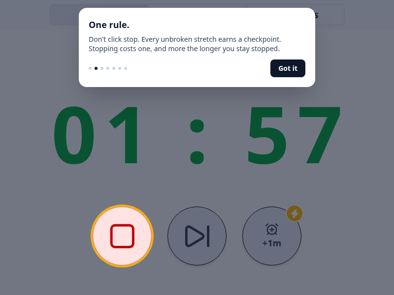

# WorkLife

A personal Pomodoro-style desktop app that enforces work boundaries through mandatory but configurable breaks. Built with Electron.

One rule: don't click stop. Work, and the break comes to you. When time's up, a window appears and keeps growing until you take it. Every unbroken stretch earns a checkpoint. Stopping costs one, and more the longer you stay stopped.

## Try it in your browser

**[Open the demo](https://ryee-dao.github.io/worklife/)**. It's the app's real screens with a simulated timer, and it starts with the same tour new users get: the one rule, what happens when time's up, and the break that takes over the screen.

<p align="left">
  
</p>

<p align="left">
 <video src="https://github.com/user-attachments/assets/679e2f5f-a3ed-4628-875a-d98e53ff655e" width="500" controls>
 </video>
</p>


## Tech Stack

- **Electron** - Desktop app framework
- **React** - UI components
- **TypeScript** - Type safety
- **Vite** - Fast build tooling
- **Tailwind CSS** - Styling
- **Playwright** - E2E testing
- **Vitest** - Unit testing

## Installation

Download the latest installer for your platform:

**Windows:**
1. Download `WorkLife Setup.exe` from [releases](https://github.com/ryee-dao/worklife/releases)
2. Run the installer
3. Launch WorkLife from Start Menu

**macOS:**
1. Download `WorkLife.dmg` from [releases](https://github.com/ryee-dao/worklife/releases)
2. Open the DMG and drag WorkLife to Applications
3. Launch from Applications folder

## Local Development

### Prerequisites
- Node.js 22+ 
- npm

### Setup
```bash
# Install dependencies
npm install
 
# Run in development mode
npm run dev
 
# Build for production
npm run build
 
# Create distributable
npm run dist
```
 
### Testing
```bash
# Unit tests
npm run test:unit
 
# End to end tests
npm run test:e2e
 
# All tests
npm run test
```
